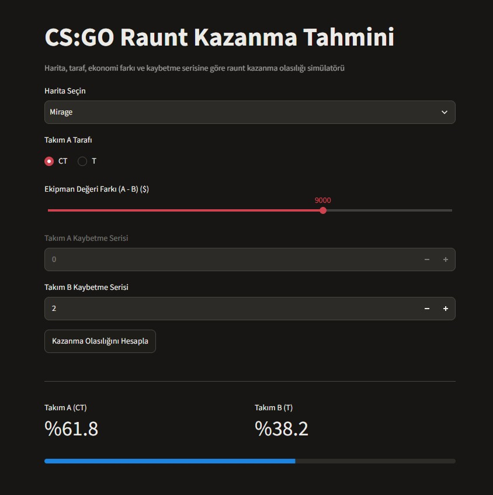
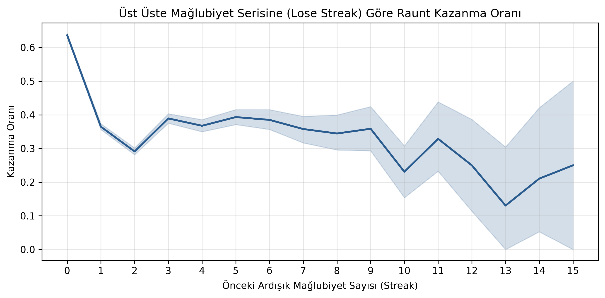

# CS:GO Raunt Sonucu Tahmini

[](https://csgoroundprediction-o4jxvrc4fx9azqit5kxn7j.streamlit.app)

Bu proje, CS:GO rekabetçi maç verileri üzerinden ekonomi farkı, harita-taraf dinamiği ve ardışık mağlubiyet serilerini (losing streak) kullanarak **Logistic Regression** ile raunt sonucunu tahmin eder.

## Canlı Web Uygulaması (Streamlit)

Modeli kurulum yapmadan doğrudan tarayıcı üzerinden test etmek için **[Canlı Demo Uygulamasını Aç](https://csgoroundprediction-o4jxvrc4fx9azqit5kxn7j.streamlit.app)** bağlantısını kullanabilirsiniz.



## Proje Özeti ve Yaklaşım

- **Veri Temizleme:** Oyuncu ve hasar bazlı tekrar eden log satırları maç ve raunt (`file`, `round`) bazında tekilleştirildi.
- **Özellik Mühendisliği (Feature Engineering):**
  - `a_eq_diff`: 15. raunttaki taraf değişimini (T $\leftrightarrow$ CT) hesaba katarak Takım A'nın mevcut raunttaki ekipman değeri avantajı.
  - `map_side`: Harita ve oynanan taraf kombinasyonu (örn. `de_mirage_T`, `de_inferno_CT`).
  - `a_prev_streak` & `b_prev_streak`: Veri sızıntısını önlemek için mevcut raundun değil, bir önceki raundun ardışık mağlubiyet serisi (`shift(1)`).
- **Modelleme:** Eğitim ve test setleri ayrıldıktan sonra özellikler yalnızca eğitim seti istatistikleriyle (`StandardScaler`) ölçeklendi ve **Logistic Regression** modeli eğitildi.

## Model Performansı

| Metrik | Skor |
| :--- | :---: |
| **Accuracy (Doğruluk)** | **%65.96** |
| **ROC-AUC** | **0.7191** |

## Görselleştirmeler

### 1. Ardışık Mağlubiyet Serisi ve Kazanma Oranı


### 2. Özellik Önem Düzeyleri (Model Katsayıları)


### 3. Model Değerlendirme (Confusion Matrix & ROC Eğrisi)


## Kurulum ve Yerel Çalıştırma

```bash
pip install -r requirements.txt
streamlit run app.py
```

## Kullanılan Teknolojiler
- **Python** (`pandas`, `numpy`, `scikit-learn`, `matplotlib`, `seaborn`, `joblib`)
- **Streamlit** (Web Arayüzü ve Deployment)
- **Jupyter Notebook**

## Veri Seti
Bu çalışmada Kaggle üzerindeki [CS:GO Competitive Matchmaking Data](https://www.kaggle.com/datasets/skihikingkevin/csgo-matchmaking-damage) veri seti kullanılmıştır. Dosya boyutu nedeniyle ham veri repoya dahil edilmemiştir.
streamlit run app.py
