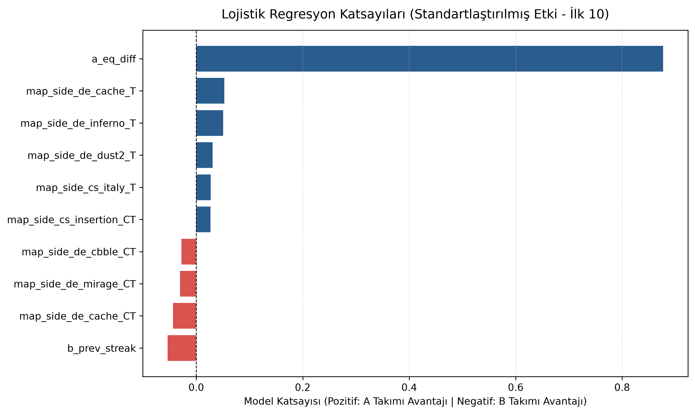
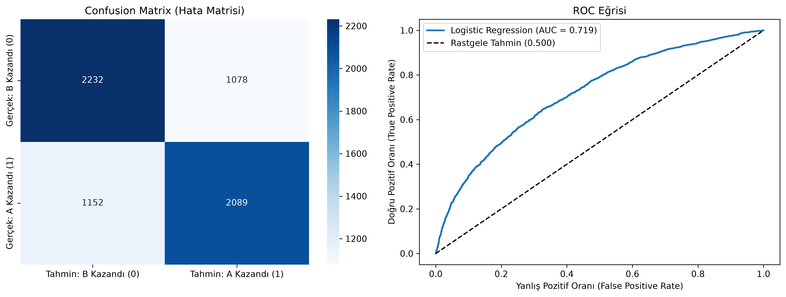

# CS:GO Raunt Sonucu Tahmini

Bu proje, CS:GO rekabetçi maç verileri üzerinden ekonomi farkı, harita-taraf dinamiği ve ardışık mağlubiyet serilerini kullanarak Logistic Regression ile raunt sonucunu tahmin eder.

## Canlı Web Uygulaması (Streamlit)

## Proje Özeti ve Yaklaşım

- **Veri Temizleme:** Oyuncu ve hasar bazlı tekrar eden log satırları maç ve raunt (`file`, `round`) bazında tekilleştirildi.
- **Özellik Mühendisliği:**
  - `a_eq_diff`: 15. raunttan sonraki taraf değişimini (T ↔ CT) hesaba katarak Takım A'nın mevcut raunttaki ekipman değeri avantajı.
  - `map_side`: Harita ve oynanan taraf kombinasyonu (örn. `de_mirage_T`, `de_inferno_CT`).
  - `a_prev_streak` & `b_prev_streak`: Veri sızıntısını önlemek için mevcut raundun değil, bir önceki raundun ardışık mağlubiyet serisi (`shift(1)`).
- **Modelleme:** Eğitim ve test setleri maç (`file`) bazında ayrıldı, özellikler yalnızca eğitim seti istatistikleriyle ölçeklendi ve Logistic Regression modeli eğitildi.

## Model Performansı

| Model | Accuracy | ROC-AUC |
| :--- | :---: | :---: |
| Baseline | %50.92 | - |
| Sadece ardışık mağlubiyet serisi | %64.64 | 0.6488 |
| Sadece ekipman farkı | %65.01 | 0.7099 |
| Tüm özellikler | %65.19 | 0.7116 |

Tahmin gücünün büyük kısmı ekipman farkından geliyor. Mağlubiyet serisi özelliği de tek başına anlamlı bilgi taşıyor ancak ekipman farkıyla yaklaşık ±0.54 korelasyonları olduğu için birlikte kullanıldıklarında ek katkıları çok küçük kalıyor (+0.18 puan accuracy). 

## Görselleştirmeler

### 1. Ardışık Mağlubiyet Serisi ve Kazanma Oranı

### 2. Model Katsayıları

### 3. Model Değerlendirme (Confusion Matrix & ROC Eğrisi)

## Kullanılan Teknolojiler
- **Python** (`pandas`, `numpy`, `scikit-learn`, `matplotlib`, `seaborn`, `joblib`)
- **Streamlit** (Web Arayüzü ve Deployment)
- **Jupyter Notebook**

## Veri Seti
Bu çalışmada Kaggle üzerindeki [CS:GO Competitive Matchmaking Data](https://www.kaggle.com/datasets/skihikingkevin/csgo-matchmaking-damage) veri seti kullanılmıştır. Dosya boyutu nedeniyle ham veri repoya dahil edilmemiştir.
